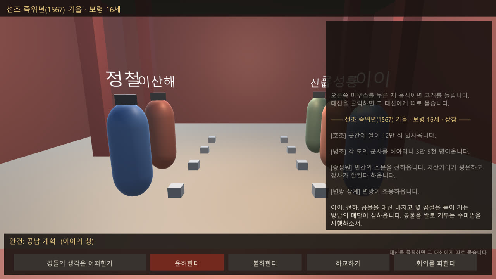
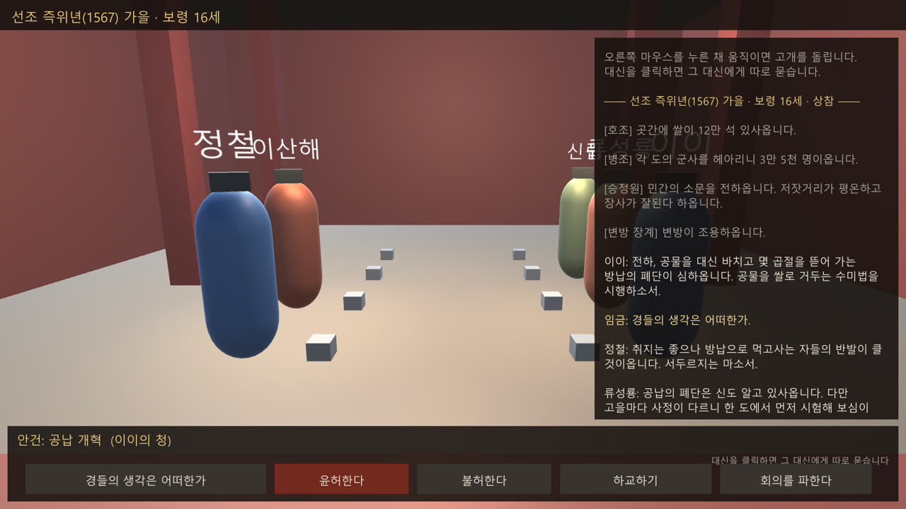
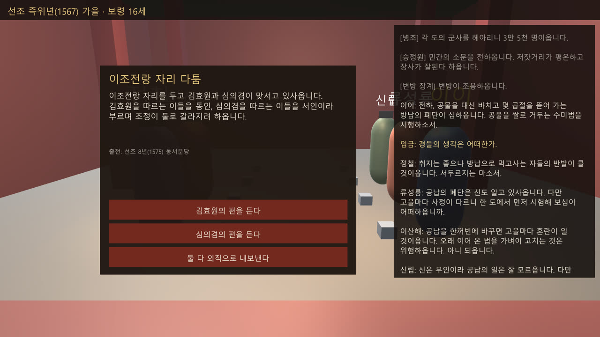
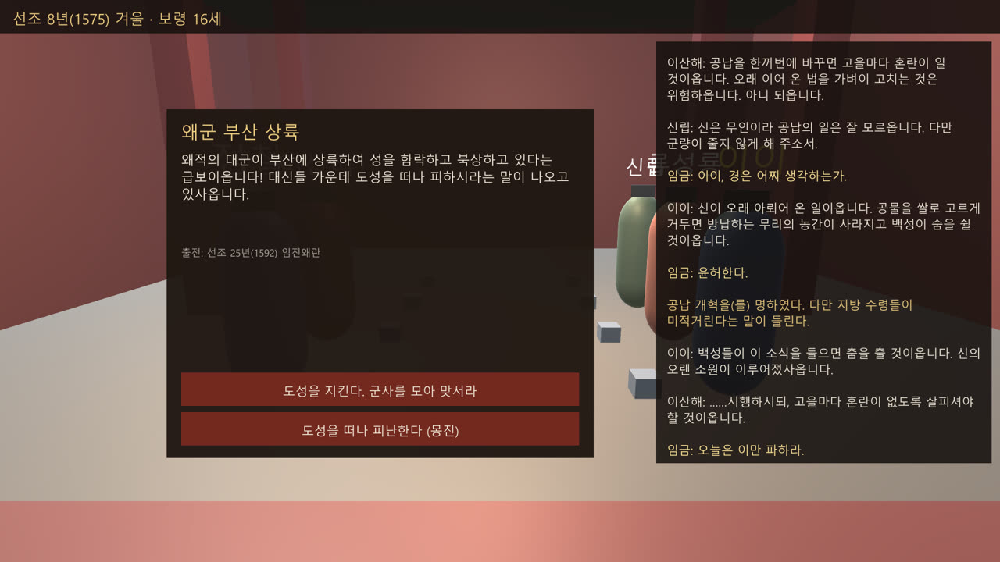
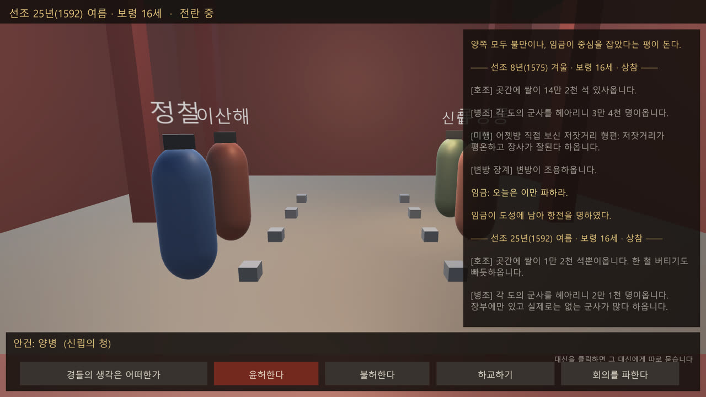

# 왕의 하루 — 유니티 프로토타입 v0.2

조선 임금이 되어 편전 용상에 앉아 대신들과 국정을 운영하는 1인칭 게임입니다.
이 폴더 자체가 유니티 프로젝트입니다.

| 대신들의 의견 | 실록 사건: 동서분당 |
| --- | --- |
|  |  |
| **임진왜란 발발** | **전시 위기 아침 (옥체 위중)** |
|  |  |

## 핵심 설계

- **숫자 없는 국정:** 화면에 게임 수치가 없습니다. 곳간은 "쌀 12만 석", 군사는 "3만 5천 명"으로 보고되고, 민심과 외적 소식은 오차와 아첨이 섞인 소문으로 옵니다. 왕권이 약하면 어명이 지방에서 덜 시행됩니다.
- **대본식 대신 회의:** LLM 없이 대신 5명 × 어명 12개 전 조합과 정황별 변형 109줄로 돌아갑니다. 동접자 수와 상관없이 운영비가 0원입니다.
- **규칙과 엔진 분리:** `Scripts/Core`는 Unity에 의존하지 않는 순수 C#입니다. `Tools/BalanceTest.cs`로 Unity 없이 수백 판을 자동으로 돌려 밸런스를 봅니다.
- **데이터 주도:** 어명·대신·사건·대사가 모두 JSON입니다. 빠진 대사 조합은 시작할 때 자동으로 알려 줍니다.
- **자동 플레이테스트 촬영:** 메뉴 `왕의 하루 → 자동 플레이테스트 촬영`을 누르면 게임이 혼자 하루를 진행하며 주요 장면을 `PlaytestShots/`에 저장합니다.

## 여는 법

1. Unity Hub를 설치하고, Installs 탭에서 **Unity 6**(버전 6000.x 아무거나)를 설치합니다.
2. 받은 압축을 풉니다. 예: `바탕화면\JoseonKing`
3. Unity Hub → Projects → **Add**(추가) → **Add project from disk** → 압축 푼 `JoseonKing` 폴더를 고릅니다.
4. 목록에 생긴 프로젝트를 누릅니다. 버전이 다르다는 창이 뜨면 설치한 Unity 6 버전을 골라 엽니다. 처음 열 때는 몇 분 걸립니다.
5. 에디터가 열리면 위쪽 가운데 **▶ Play**를 누릅니다. 빈 씬이어도 편전, 대신, 화면이 저절로 생깁니다.

## 조작

- 오른쪽 마우스를 누른 채 움직이기: 고개 돌리기
- 대신 클릭: 그 대신에게 지금 안건을 따로 묻기
- 아래 막대: 경들의 생각은 어떠한가 / 윤허한다 / 불허한다 / 하교하기 / 회의를 파한다
- F1: 개발용 실제 수치 보기 (플레이어용 화면에는 숫자가 없습니다)

## 하루 흐름

1. **조보(아침 보고):** 호조는 곳간의 쌀을 석 단위로, 병조는 군사를 명 단위로 보고합니다. 승정원은 민심 소문을, 변방은 장계를 올립니다.
2. **상참:** 대신이 그날 형편에 맞는 안건을 올립니다. 의견을 듣고 윤허하거나 물리칩니다. 임금이 직접 하교할 수도 있습니다. 큰 결정은 하루에 하나입니다.
3. **상소:** 사건이 하나 올라옵니다.
4. **저녁:** 휴식, 세자 교육, 연회, 미행 중 하나를 합니다.
5. **결산:** 석 달이 흐르고 다음 상참으로 넘어갑니다.

## 수치를 숨긴 장치 (현실감)

| 숨긴 수치 | 플레이어가 느끼는 방식 |
| --- | --- |
| 국고 | 호조 보고 "곳간에 쌀이 12만 석" |
| 군사 | 병조 보고 "군사 3만 5천 명", 적으면 "장부에만 있는 군사가 많다" |
| 민심 | 승정원의 소문. 오차가 있고, 왕권이 세면 좋은 말만 올라옴. 미행하면 정확히 앎 |
| 외침위협 | 변방 장계(짐작). 통신사를 보내면 정확히 앎 |
| 왕권 | 어명이 지방에서 제대로 시행되는지("수령들이 미적거린다"), 대신들의 말투 |
| 왕 건강 | 어의 진맥, 화면 가장자리가 어두워짐 |
| 전쟁 전선 | 임진왜란 실제 북상로 지명 (부산 → 동래 → 밀양 → 대구 → 상주 → 충주 → 용인 → 도성) |
| 날짜 | 실록 표기 "선조 25년(1592) 봄" |

## 대사 (LLM 없음)

대사는 전부 `Assets/StreamingAssets/JoseonKing/dialogue.json`에 들어 있습니다. 서버도 API도 쓰지 않으므로 동접자가 몇 명이든 운영비는 0원입니다.

- 대신 5명 × 어명 12개 의견 60줄, 전쟁·곳간 빔·민심 흉흉 같은 정황별 변형, 안건 올리는 말, 윤허·불허 뒤 반응까지 109줄입니다.
- 같은 상황이면 가장 구체적인 대사를 고르고, 최근에 한 말은 피합니다.
- 대신이나 어명을 추가했는데 대사가 빠지면 게임 시작 때 콘솔에 "대사 빠짐: 누구 × 무엇"이 뜹니다.

## 에셋 바꾸기 (AI 3D 에셋)

Hierarchy에서 우클릭 → Create Empty → Add Component → `GameBootstrap`. 그다음 `Assets` 항목에 프리팹을 넣고 씬을 저장합니다.

| 슬롯 | 넣을 것 | 기준점 |
| --- | --- | --- |
| Palace Prefab | 편전 내부 전체 | 원점 = 편전 바닥 중앙. 용상은 +Z 쪽 약 7m |
| Throne Prefab | 용상 + 일월오봉도 | (0, 0, 7)에 놓임. 단 높이 0.8m 가정 |
| Ministers | 대신 ID별 프리팹 (`yi_i`, `jeong_cheol`, `ryu_seongryong`, `yi_sanhae`, `sin_rip`) | 발밑이 원점, +Z가 앞 |

애니메이션: 대신 프리팹의 Animator에 트리거 `Talk`, `Idle`, `Bow`가 있으면 게임이 부릅니다.

## 내용 추가 (코드 수정 없이 JSON만)

- `policies.json`: 어명. `command`는 임금이 하교하는 문장이고, `agenda`는 대신이 이 안건을 올리는 조건입니다.
- `ministers.json`: 대신. `supports` / `opposes`에 어명 ID를 넣습니다. `leaveYear`가 되면 퇴장합니다.
- `events.json`: 사건. 조건과 선택지를 넣습니다. `chance`는 꼭 적어야 합니다(0 이하면 항상 발생).
- `dialogue.json`: 대사. `kind`(propose/opinion/approved/rejected/weak_tail), `minister`, `policy`, `context`(war/poor/unrest/weak), `stance`로 나뉩니다.

수치 키: people, treasury, military, authority, threat, health, heir, east, west. 조건에는 front, enemy, age, year, faction_gap도 씁니다.

## 밸런스 확인

`Tools/BalanceTest.cs`는 유니티 없이 수백 판을 자동으로 돌려 엔딩 분포를 봅니다. 실행 방법은 파일 첫 줄에 있습니다.

## 알려진 한계

- UI는 uGUI 기본 Text입니다. OS 한글 폰트(맑은 고딕 등)를 씁니다.
- 저장/불러오기가 없습니다.
- 역사 사건은 1593년까지만 있고, 그 뒤로는 일상 사건만 반복됩니다.
- 마우스가 안 먹으면: Edit → Project Settings → Player → Active Input Handling을 **Both**로 바꾸세요.
